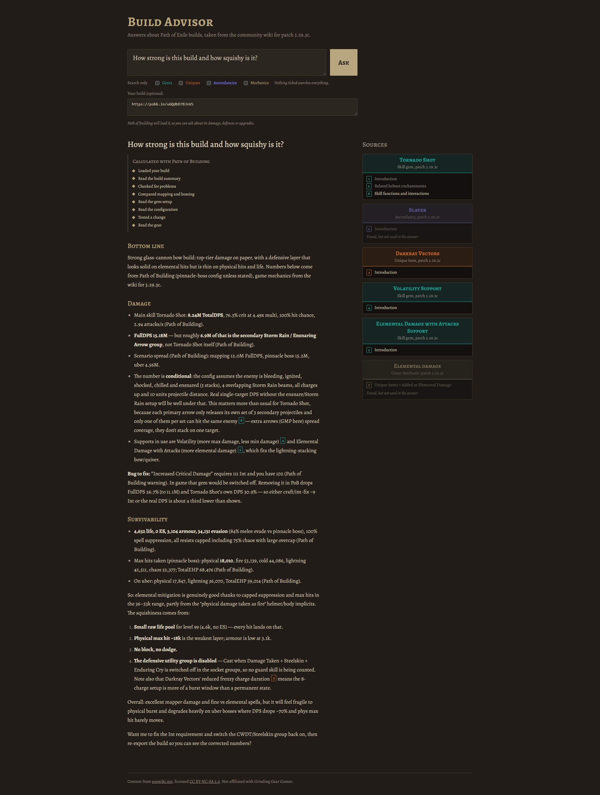

# build-advisor

Ask questions about Path of Exile builds and get answers grounded in the
[Path of Exile wiki](https://www.poewiki.net), with links to the pages used.

> *"Which support gems work with Righteous Fire Chieftain?"*

**Live demo: [2.29.162.98.sslip.io](https://2.29.162.98.sslip.io/)** — paste a
[pobb.in](https://pobb.in) link to ask about your own build. The demo answers
100 questions a day in total, so it may be out for the day.



Built with Django, PostgreSQL + pgvector, local `bge-m3` embeddings and an
LLM behind a provider-agnostic interface (DeepSeek by default). For questions
about a concrete build the model can also drive
[Path of Building](https://github.com/PathOfBuildingCommunity/PathOfBuilding)
through [pob-mcp](https://github.com/wahid/pob-mcp): load your build, rank
support gems, test changes, or create a build and hand you the share code.

## Status

| Phase | | Status |
|---|---|---|
| 1 | Collect wiki data (gems, uniques, ascendancies, mechanics) | ✅ done |
| 2 | Chunking + embeddings | ✅ done |
| 3 | RAG pipeline + React frontend with sources | ✅ done |
| 4 | Tool calling with pob-mcp | ✅ done |
| 5 | Evaluation set in CI | ✅ done |
| 6 | Public demo (Hetzner) | ✅ [live](https://2.29.162.98.sslip.io/) |

## Quick start (Docker)

```bash
cp .env.example .env          # set WIKI_USER_AGENT and the LLM_* settings
docker compose up --build     # app on http://localhost:5173, API on :8000, plus Celery, Postgres, Redis
```

In another terminal:

```bash
docker compose exec web python manage.py fetch_wiki --type gem --limit 20   # small trial run
docker compose exec web python manage.py fetch_wiki                         # everything (slow: one request per 2.5 s)
docker compose exec web python manage.py fetch_wiki --async                 # run in the Celery worker
docker compose exec web python manage.py createsuperuser                    # browse data at /admin/
```

Health check: `GET /api/health/`.

### Building the search index

```bash
docker compose exec worker python manage.py build_index --limit 50   # trial: embed 50 chunks
docker compose exec worker python manage.py build_index              # chunk + embed everything
docker compose exec web python manage.py build_index --async         # same, as a Celery task
```

The first run downloads `bge-m3` (~2 GB) into a Docker volume.

### Asking questions

Set `LLM_PROVIDER`, `LLM_MODEL` and `LLM_API_KEY` in `.env` (then
`docker compose up -d` to reload it), and:

```bash
docker compose exec worker python manage.py search "Cast when Damage Taken"   # retrieval only
docker compose exec worker python manage.py ask "Which support gems work with Righteous Fire Chieftain?"
```

Or over HTTP, streamed as Server-Sent Events (`sources`, then `delta`s, then `done`):

```bash
curl -N -X POST http://localhost:8000/api/ask/ -H "Content-Type: application/json" \
  -d '{"question": "How does ignite work?", "doc_types": ["mechanic"]}'
```

Add `"stream": false` for a single JSON response.

### Using an NVIDIA GPU

Embedding the whole wiki on CPU is slow. With an NVIDIA card (Docker Desktop on
Windows uses it through WSL2), start the stack with the GPU override:

```bash
docker compose -f docker-compose.yml -f docker-compose.gpu.yml up --build
```

This builds PyTorch with CUDA and gives the Celery worker the GPU. The deployed
server stays on the CPU build: it only embeds the user's question, and the
document embeddings are already in the database.

## How data collection works

- **Page lists** come from the wiki's MediaWiki API: gems and uniques via
  Cargo queries on the `items` table, ascendancies and mechanics via categories.
- **Only changed pages are fetched.** Revision ids are checked in batches of 50;
  pages whose revision matches the stored `Source.revision_id` are skipped.
- **Polite to the wiki:** one request per 2.5 s by default (Cloudflare challenges faster clients), `maxlag=5`,
  backing off on `429`/`503` with `Retry-After`, and a descriptive User-Agent.
- **Optional proxies and parallel downloads:** list proxies in `proxies.txt`
  (one per line, see `proxies.example.txt`; http, https, socks4 and socks5) or
  in `WIKI_PROXIES`. Pages are then downloaded by `WIKI_WORKERS` threads
  (default 4, max 16), each with its own home proxy. When a proxy fails
  (connection error, timeout, `407`/`502`/`504`) the request moves to another
  proxy and the failed one is skipped for `WIKI_PROXY_COOLDOWN` seconds. Each
  worker still keeps its own request interval and backoff, and a Cloudflare
  challenge stops the whole run.
- **`fetch_wiki --direct`** skips the proxies and fetches pages one at a time
  over your own connection, throttled to `WIKI_REQUEST_INTERVAL` and backing
  off on `429`/`503`. Use it to retry pages that failed through proxies; only
  missing or changed pages are downloaded.
- **Raw pages are cached** in `data/raw/` per revision, so re-parsing never
  needs the network.
- **HTML → text** keeps section headings as `##` lines (for per-section
  chunking in phase 2) and drops navboxes, references and images.
- **Patch tracking:** each `Document` stores the game version it applies to,
  taken from the wiki's version table (latest released version) unless
  `POE_PATCH` is set.

## How indexing works

- **Chunks follow the wiki's sections**, not a fixed length. Long sections are
  split on paragraph boundaries (max `CHUNK_MAX_CHARS`, default 1500).
- Every chunk starts with `<page> — <section path>` so the embedding knows
  where it came from; reference and "see also" sections are dropped.
- Each `Chunk` carries type, patch, URL and section for filtering and citing.
- **Embeddings:** `BAAI/bge-m3` via sentence-transformers, normalised, stored
  in pgvector (1024 dimensions) with an HNSW index for cosine similarity.
- **Only changed text is re-embedded.** Documents are re-chunked only when
  their text hash changes, and chunks whose text is unchanged keep their
  embedding. Switching `EMBEDDING_MODEL` re-embeds everything.

## Frontend

React + TypeScript (Vite) in `frontend/`, laid out as a chat: ask follow-ups
in the same conversation, attach a build once and it stays attached, start
over with "New chat" (the last conversation is kept in the browser). Each
answer has its sources below it, drawn like in-game item tooltips, coloured
by page type (gems teal, uniques orange, ascendancies
blue, mechanics gold); citation markers in the answer share their source's
colour, highlight it on hover and link to the wiki page.

- **Development:** `docker compose up` runs the Vite dev server on
  http://localhost:5173 with live reload; `/api` is forwarded to Django.
- **Production:** the Dockerfile builds the app in a Node stage and Django
  serves it at `/` through WhiteNoise, so one container serves everything.
- `cd frontend && npm test` runs the parser and streaming tests.

## Path of Building tools

When pob-mcp is available (the Docker image includes it), the model gets a
set of Path of Building tools next to the wiki sources. Ask with a build
attached ("which support should replace Elemental Focus?") or ask it to create
one ("make a level 90 RF Chieftain"); the frontend shows each step and the
resulting share code to import into PoB.

- **Same numbers as PoB:** pob-mcp boots Path of Building's own Lua engine
  headlessly, so stats match the PoB app.
- **Pool of processes:** PoB takes ~5 s to boot and holds one build, so a small
  pool (`POB_POOL_SIZE` per web/worker process) is kept warm. Each question gets
  its own process, reset with `new_build`, so visitors never see each other's
  builds.
- **Follow-ups keep the build loaded:** a process remembers which build it holds
  and whether any tool changed it. A follow-up with the same build reuses it
  instead of resetting and loading it again. When the model changes a build,
  the app attaches the exported share code, so the next question continues from
  the changed build (and the process already holds exactly that code).
- **Bounded tool loop:** at most `POB_MAX_TOOL_ROUNDS` rounds (default 8); the
  last round has no tools, so the model must answer. Every call is logged with
  its arguments and duration.
- **Safe for a public site:** the model only sees an allowlist of 26 tools
  (`advisor/pob.py`). File arguments are stripped (`export_build` can't write,
  `load_build` only takes share codes and pobb.in / pastebin links), and
  poe.ninja's ladder tools are left out because its builds API isn't open to
  third parties.
- **Attached builds are loaded by the app**, not by the model, so a 20 KB share
  code isn't sent through the LLM.

Locally without Docker, clone Path of Building and set `POB_PATH`:

```bash
git clone --depth 1 https://github.com/PathOfBuildingCommunity/PathOfBuilding ~/PathOfBuilding
POB_PATH=~/PathOfBuilding uv run python manage.py ask "Create a level 90 RF Chieftain" \
  --build "https://pobb.in/..."   # optional
```

## How answering works

0. **Query rewriting and routing** (`advisor/rewrite.py`, on when an LLM is
   configured): one quick LLM call, with thinking switched off, turns the
   question into wiki terms ("can something cast my spells for me?" becomes
   "Spell Totem Support, Totem") and decides whether it needs Path of
   Building. Only build questions get the PoB tools (~10k prompt tokens), so
   the first word of a wiki answer arrives after ~3-4 s instead of ~15 s.
   For a follow-up it also gets the earlier turns and rewrites the question to
   stand on its own ("and bleed?" becomes "how do multiple bleeds stack?").
1. **Hybrid retrieval** (`wiki/search.py`) merges three ranked lists with
   reciprocal rank fusion: vector similarity, Postgres full-text search, and
   chunks of pages whose title appears in the question (one per page first,
   so "Righteous Fire Chieftain" finds both pages; one-word titles that are
   common words, like "Damage", don't count). Common words ("support", "gem")
   are ignored for keyword search, and at most 3 chunks per page are kept.
   Reference sections (version history, item acquisition, lists of related
   mods and passives) count half unless the question asks for a list, so
   they don't crowd out the sections that explain a mechanic. With an
   attached build, the pages of its main skill, ascendancy, uniques and
   supports come first.
2. **Grounded prompt** (`advisor/prompts.py`): the top 8 chunks are numbered;
   the model answers from them and cites them as `[n]`. Where they fall short
   it may add well-established game knowledge, marked "(general game
   knowledge)" and never cited, but no invented numbers or item names.
   Earlier turns of the conversation come before the question (last 6, their
   old citation marks removed).
3. **Provider-independent LLM** (`advisor/llm.py`): DeepSeek, OpenAI and
   Anthropic through their OpenAI-compatible APIs, chosen by `LLM_PROVIDER`,
   with streamed tool calls. Model names live only in configuration.
4. **Tools** (`advisor/rag.py`): when the model calls Path of Building tools,
   results go back to it until it answers; numbers from PoB are reported as
   such, wiki facts keep their `[n]` citations.
5. **Web search** (`advisor/websearch.py`, DeepSeek only): the model can call
   `web_search` for what the wiki doesn't cover, like the current league or
   recent patch notes. It goes through DeepSeek's Search API with the same key,
   at most twice per question, and only results from a few Path of Exile sites
   are kept (official site, wiki, maxroll, mobalytics, Reddit; translations and
   duplicates dropped). Results become numbered sources the model cites like
   the wiki, shown as "Web page" cards with their site and date. The evals run
   without it, so scores don't change with the web.
6. **Streaming** (`POST /api/ask/`): sources first, then tool steps, the
   answer token by token, an exported share code if any, and finally which
   sources were cited.

## Evaluation

53 questions in [`evals/questions.yaml`](evals/questions.yaml): mechanics, gems,
uniques, ascendancies, indirect questions that don't name the page ("why do
enemies take more damage after a lightning hit?"), questions the wiki can't
answer (the advisor must say so) and Path of Building build requests. Each case lists the wiki pages that should
be retrieved and facts the answer must contain.

- **Retrieval:** is an expected page among the top 8 chunks (hit@8), how many of
  the expected pages are found (recall@8), and how high (MRR).
- **Answers:** required facts present, only valid `[n]` citations, the expected
  PoB tools called, and an LLM judge that rates groundedness and relevance
  (1-5) against the retrieved sources.

CI ([`evals.yml`](.github/workflows/evals.yml)) indexes a fixed slice of the
wiki (`evals/corpus.jsonl.gz`, the expected pages plus distractors) and runs the
set weekly and on changes to retrieval or prompts; answers are judged when an
`LLM_API_KEY` secret is set.

```bash
python manage.py run_evals                              # retrieval only
python manage.py run_evals --answers --update-readme    # answers + judge, scores below
```

<!-- evals:start -->
_2026-11-11, patch 3.29.3c, 2925 wiki pages, 26962 chunks, query rewriting, answers by deepseek/deepseek-flash._

| Metric | Score |
|---|---|
| Expected page in top 8 | 100% |
| Expected pages found (recall@8) | 98% |
| Mean reciprocal rank | 0.90 |
| Cases passed | 96% |
| Required facts mentioned | 98% |
| Answers with only valid citations | 100% |
| Groundedness (judge, 1-5) | 4.48 |
| Relevance (judge, 1-5) | 4.96 |
| Says so when the wiki doesn't cover it | 100% |

| Category | Cases | Hit@8 | Passed |
|---|---|---|---|
| mechanic | 18 | 100% | 94% |
| gem | 10 | 100% | 100% |
| unique | 5 | 100% | 100% |
| ascendancy | 5 | 100% | 100% |
| indirect | 8 | 100% | 100% |
| unanswerable | 5 | n/a | 100% |
| build | 2 | 100% | 50% |

<details><summary>2 failing cases</summary>

- `leech-recovery`: missing: damage dealt / damage you deal / damage done / damage the enemy takes / damage taken / based on damage / of the damage / of damage
- `build-create-rf`: judge: grounded 2, relevant 3 (The answer cites wiki mechanics correctly but fabricates most build specifics (gems, ascendancy, gear, passives, DPS) that the Path of Building results do not show, and the export is a near-empty skeleton.)

</details>
<!-- evals:end -->

## Deployment

Production runs on one Hetzner CX23 (2 vCPU, 4 GB, ~€5.49/month) with
[`docker-compose.prod.yml`](docker-compose.prod.yml): Caddy (automatic HTTPS,
unbuffered streaming) → gunicorn (1 worker, 8 threads, 300 s timeout for
streamed builds) → Postgres + pgvector. The embedding model and a Path of
Building process are loaded at startup. The public demo is limited to
`ASK_DAILY_LIMIT` questions per day (default 100) and `ASK_RATE_LIMIT` per
visitor. Every push to `main` that passes CI is deployed over SSH
([`deploy.yml`](.github/workflows/deploy.yml)).

Step by step: [docs/deploy-hetzner.md](docs/deploy-hetzner.md).

## CI

| Workflow | When | What |
|---|---|---|
| [`ci.yml`](.github/workflows/ci.yml) | every push and PR | ruff, migrations check, pytest against Postgres + pgvector; frontend types, tests and build |
| [`evals.yml`](.github/workflows/evals.yml) | weekly, on demand, and on retrieval/prompt changes | indexes the eval corpus and scores retrieval; also answers + judge when `LLM_API_KEY` is set |
| [`docker.yml`](.github/workflows/docker.yml) | when the Dockerfile or dependencies change, and weekly | builds the production image and runs [`scripts/smoke_test.sh`](scripts/smoke_test.sh) in it |
| [`deploy.yml`](.github/workflows/deploy.yml) | after CI passes on `main`, or by hand | SSH to the server and run [`deploy/deploy.sh`](deploy/deploy.sh) (secrets `DEPLOY_HOST`, `DEPLOY_SSH_KEY`) |

Repository settings for the evals: secret `LLM_API_KEY`, and optionally the
variables `LLM_PROVIDER` and `LLM_MODEL` (default `deepseek` / `deepseek-flash`).

## Development

```bash
uv sync                      # Python 3.12 (add --extra cpu or --extra cuda for embeddings)
uv run pytest                # tests (wiki and LLM calls are mocked)
uv run ruff check . && uv run ruff format .
```

Tests use `DATABASE_URL`; CI runs them against Postgres with pgvector.

## Data licence

Wiki content is from [poewiki.net](https://www.poewiki.net), under a Creative
Commons non-commercial licence ([CC BY-NC-SA 3.0](https://creativecommons.org/licenses/by-nc-sa/3.0/)). This project is non-commercial and links every answer back to
its source page. Path of Exile is a trademark of Grinding Gear Games.
